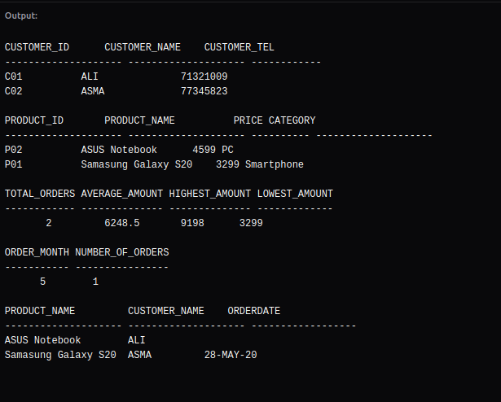

# Data Query Language

## Overview

This checkpoint implements SQL queries to retrieve data from our tables using DQL language.

The database contains three tables:

- **CUSTOMER** stores customer information.
- **PRODUCT** stores product information.
- **ORDERS** stores orders and their corresponding quantities and amounts.

## Output of SQL queries

